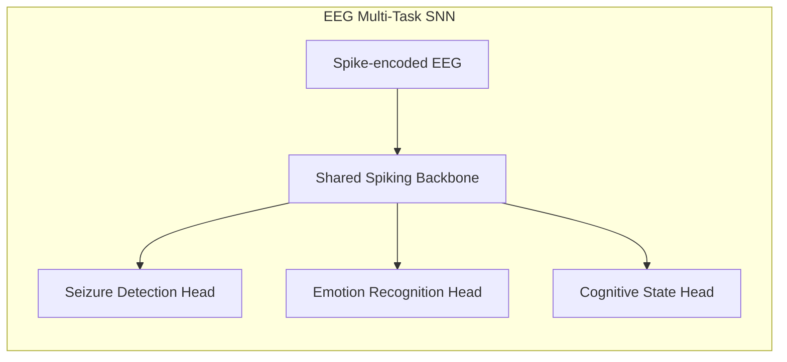
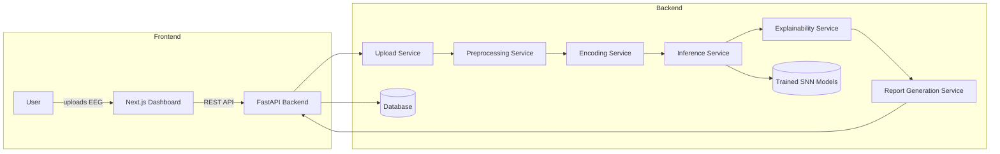
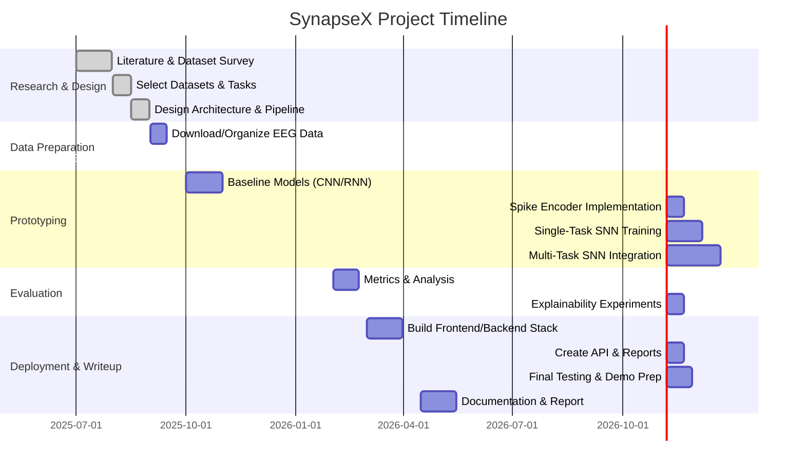

# Executive Summary

**SynapseX** is envisioned as a **Neurological Intelligence Platform** that performs *multi-task EEG analysis* entirely in software using public datasets.  It leverages **Spiking Neural Networks (SNNs)** – bio-inspired, event-driven models – to efficiently decode brain signals for **seizure detection**, **emotion recognition**, and **cognitive-state estimation**.  Unlike traditional point solutions, SynapseX’s novelty lies in a **shared spiking backbone** with task-specific output “heads”, enabling simultaneous multi-domain inference on a single EEG input. This multi-task SNN approach (augmented by explainable AI techniques) promises **power-efficient**, yet **high-performance**, EEG analysis. For example, recent work showed that an SNN on neuromorphic hardware consumed *95% less energy* than a comparable deep network while matching its accuracy. We will train the backbone on large EEG corpora (e.g. TUH, CHB-MIT, DEAP, SEED, DREAMER) and validate it across tasks.  The system’s **modular architecture** (with separate services for upload, preprocessing, encoding, inference, etc.) and efficient ML techniques (quantization, pruning, batching) will ensure it’s **feasible**, **fast**, and **practical** for deployment.  This report details SynapseX’s goals, data sources, pipeline design, SNN methods, training/evaluation plans, deployment stack (Next.js frontend, FastAPI+PyTorch backend), experiment timeline, and risk mitigation – providing a comprehensive blueprint for an **open, reproducible** final-year project.

## Project Goals & Novelty

- **Multi-Task Neurological Intelligence:** Instead of a single classifier, SynapseX will *simultaneously* analyze EEG for multiple targets: detecting epileptic seizures, classifying emotional state (e.g. valence/arousal), and estimating cognitive factors like attention or fatigue.  
- **Spiking Neural Network Backbone:** We adopt an SNN which naturally processes time-series spikes and integrates information over time, leading to high energy-efficiency. A shared *spatio-temporal feature extractor* (convolutional + recurrent SNN layers) will serve all tasks, followed by separate output “heads” for each task domain. This multi-task learning (MTL) design improves data efficiency and can capture cross-task correlations (e.g. low attention often co-occurs with increased fatigue).  
- **Explainability and Reliability:** SynapseX will include an AI explainability layer (attention maps, spectral perturbation, SHAP/LIME-like analysis) to rationalize predictions in terms of EEG features or brain regions. It will also calibrate its confidence scores (e.g. via temperature scaling) and check cross-task consistency (flagging contradictory outputs) to improve trustworthiness.  
- **Power-Efficiency:** Unlike standard deep learning, our SNN model is designed to be **sparse and event-driven**, which inherently reduces computation and memory use. We will further apply model compression (quantization to INT8, pruning) and consider ONNX export to run on low-power hardware. The goal is fast inference (milliseconds) with minimal energy per sample, making SynapseX suitable for embedded or cloud-edge hybrid deployment.  
- **Open and Reproducible Architecture:** The software will be organized as a clean **modular monolith** (inspired by clean architecture), not a thrown-together script. Each service (upload, preprocessing, encoding, inference, etc.) lives in its own file/folder, with clear APIs and Pydantic-based schemas. The stack (Next.js + FastAPI + PyTorch/snnTorch/Norse + MNE-Python) mirrors industry best practices for AI systems. We will publish code, datasets, and Docker scripts to maximize reproducibility.

Taken together, SynapseX is **novel** as a unified platform combining **neurological** (seizure, pathology) and **affective/cognitive** EEG analysis with *spiking deep learning*, explainability, and efficient deployment – advancing beyond typical single-task EEG apps. This ambitious scope is feasible thanks to the wealth of public EEG data and mature ML tools, yet it offers a research-grade contribution (potential IEEE paper).  

## Datasets (Public EEG Corpora)

We will leverage **multiple public EEG datasets** spanning our target tasks. Key datasets include:

| Dataset           | Domain           | Subjects | EEG Channels | Sampling Rate | Notes/Labels                          |
|-------------------|------------------|----------|--------------|---------------|---------------------------------------|
| **TUH-EEG**       | Clinical EEG/Seizures  | 10,874 (ages 0–90) | 21–64 (varies) | 250–512 Hz (mostly 250) | 16,986 sessions of clinical EEG; includes seizure vs non-seizure labels (reports). *Largest public corpus* (≈20K EEG recordings). |
| **CHB-MIT**       | Epilepsy/Seizures | 22 (pediatric)    | ~23           | 256 Hz        | 23 scalp channels; 182 annotated seizures. Standard benchmark for seizure detection.  |
| **Bonn Univ. (Dataset A/B)** | Epilepsy | – (5 sets of 100 each) | 1 (single channel) | 173.6 Hz |  Sets A-E (10-min each) covering normal vs seizure. (Commonly used for testing EEG classifiers.) |
| **DEAP**          | Emotion   | 32             | 32             | 512 Hz        | 40 music video trials (1 min each); ratings on valence/arousal/dominance. Multimodal (we use EEG only) for emotion classification. |
| **SEED / SEED-IV** | Emotion | 15–20         | 62            | 1000 Hz (downsampled) |  Video stimuli for 5 (or 4) emotions; continuous ratings. Data collected with Neuroscan (62 electrodes). |
| **DREAMER**       | Emotion   | 23              | 14             | 128 Hz       | 18 affective videos; EEG (14 channels) + ECG; valence/arousal labels.  |
| **Mental Workload** | Cognitive (Attention/Fatigue) | (various) | (EEG + peripheral) | (100–256 Hz) |  New datasets (e.g. pilot mental workload EEG, driving fatigue EEG). Potentially use tasks from BCI competitions for attention/fatigue. |
| **EEG Motor Imagery (BCI)** | Motor/Cognitive | 109 (eegmmidb)  | 64             | 160 Hz     | PhysioNet EEG Motor/Imagery (MI) dataset (could proxy cognitive load via mental tasks). |


- **Dataset Prioritization:** We will use large, diverse datasets for each task. For seizure analysis, **TUH-EEG** and **CHB-MIT** are primary (free, richly annotated). For emotion, **DEAP** (32 ch, 32 subs), **SEED** (62 ch, 15–20 subs), and **DREAMER** (14 ch, 23 subs) cover both subject variety and channel counts. For cognitive states (attention, fatigue), no single gold-standard public set exists, so we may combine BCI datasets (e.g. motor tasks) with specialized workload/fatigue datasets (e.g. [4], [5]).  Table 1 (below) summarizes key stats:

```markdown
| **Dataset** | **Use-case** | **Subjects** | **Channels** | **Hz** | **Duration/Trials** | **Labels** |
|---|---|---|---|---|---|---|
| TUH-EEG | Seizure/clinical | 10,874 | 21–64 | 250–512 (mostly 250) | 16,986 sessions (minutes to hours) | Clinician reports (seizure vs normal) |
| CHB-MIT | Pediatric epilepsy | 22 | ~23 | 256 | 18-48 hr recordings (182 seizures) | Seizure annotations |
| DEAP | Emotion | 32 | 32 | 512 | 40×60s trials | Valence/Arousal/Dominance (1–9) |
| SEED (Zheng & Lu) | Emotion | 15–20 | 62 | 1000 (↓200) | 15–20 trials (2–5 min each) | 5 emotions (continuous) |
| DREAMER | Emotion | 23 | 14 | 128 | 18 trials (60s) | Valence/Arousal (1–5) |
| Motor Imagery (PhysioNet) | Cognitive/Motor | 109 | 64 | 160 | 560 trials (4s each) | 2-class MI (open/close) |
| Workload/Fatigue | Cognitive | 10–20+ | 32+ | 100–128 | ~20 min tasks | Cognitive load / fatigue scores |
```

*Table 1: Summary of prioritized EEG datasets (subjects, channels, sampling, labels)*.

These datasets cover a wide range of scenarios and ensure the SNN can generalize across age groups, sensor counts, and environments.  By training on multiple corpora, the shared backbone will learn robust EEG features.

## Data Preprocessing Pipeline

All raw EEG data (in EDF, BDF, or vendor formats) will undergo a standardized pipeline using **MNE-Python** and SciPy. Key steps:

- **Loading & Resampling:** Read EDF/BDF using MNE or PyEDFlib; resample all data to a common rate (e.g. 256 or 200 Hz) to unify datasets.  Filter to a common montage (standard 10-20), using channel interpolation if necessary.  
- **Bandpass Filtering:** Apply a band-pass filter (e.g. 0.5–45 Hz) to remove DC drifts and high-frequency noise. Use a notch filter (e.g. 50/60 Hz) to suppress line interference. Filtering is done in forward/backward mode to avoid phase shifts.  
- **Artifact Detection/Removal:** Use **ICA** to isolate ocular (EOG) and cardiac (ECG) artifacts, then remove those components. Mark bad segments/channels via automated rejection (high amplitude or variance).  Interpolate or drop unusable channels/epochs.  
- **Normalization:** For each channel, z-score or min-max normalize the signal amplitude to ensure comparability across sessions. Optionally apply *common average reference*.  
- **Segmentation:** Divide continuous EEG into fixed-length windows (e.g. 2–5 seconds) with overlap. Each window becomes one SNN inference sample. For event detection tasks (seizures), label each window by majority class (seizure vs normal). For continuous tasks (valence), align window with stimulus intervals.  
- **Augmentation (optional):** To expand data, apply augmentations such as adding Gaussian noise, random channel dropout (to simulate electrode failure), slight time-shifting, or mixup of signals. For stationary tasks, time-reversal or magnitude-scaling can augment.  Data augmentation often improves generalization, especially with limited subjects.  

These steps yield clean, segmented EEG tensors ready for spike encoding. The pipeline will be implemented in a **Preprocessing Service** (fast API or script) so the same steps are applied at training and inference. 

```mermaid
flowchart TD
    RawEEG[Raw EEG Files (EDF/BDF)] --> Bandpass[Bandpass & Notch Filter]
    Bandpass --> DetectArtifacts[Detect Artifacts (ICA)]
    DetectArtifacts --> RemoveArtifacts[Remove Artifacts, Interpolate]
    RemoveArtifacts --> Normalize[Normalize Signals]
    Normalize --> Segment[Segment into Windows]
    Segment --> Output[Preprocessed EEG Windows]
```
*Figure: EEG preprocessing steps (filtering, ICA, segmentation).*

## Spike Encoding Methods

SNNs require encoding analog EEG amplitudes into discrete spike trains. We will experiment with several encoding schemes:

- **Rate Coding:** Each EEG channel’s normalized amplitude drives a Poisson spike train whose **rate** (spikes/sec) is proportional to the signal magnitude. Over a time window, higher voltages yield more spikes. This is simple but can be inefficient (dense spiking).  
- **Latency (Temporal) Coding:** Each value is converted into a spike time: large amplitudes spike early, small ones spike later (or not at all) within a fixed window. This yields at most one spike per neuron per window, improving sparsity. For example, we can encode EEG waveform gradients using delta-modulation or time-to-first-spike methods.  
- **Population Coding:** We use a bank of encoders per channel (e.g., Gaussian receptive fields) so that each analog value is represented by a *pattern* of spikes across neurons. This can capture finer detail and is robust to noise, at cost of more neurons.  
- **Hybrid Encoding:** We may combine approaches, e.g. rate coding for low frequencies and temporal for transient events (seizures).  

| **Encoding**      | **Mechanism**                                        | **Pros/Cons**                                        |
|-------------------|------------------------------------------------------|------------------------------------------------------|
| Rate Coding       | Spike frequency ∝ signal amplitude                   | Simple; captures intensity. *Cons:* many spikes (energy cost).    |
| Temporal (Latency)| Spike time ∝ inverse of amplitude (earlier = larger) | Sparse (max 1 spike); captures temporal info precisely. *Cons:* sensitive to noise timing. |
| Population Coding | Signals encoded via a distributed neural population (e.g. receptive fields) | High resolution; can represent complex patterns. *Cons:* large network size, complex to tune. |
| Delta Modulation  | Encode changes (derivative) of the signal as spikes  | Highlights transitions (good for seizure spikes). *Cons:* may miss steady-state info. |

*Table 2: Comparison of spike-encoding schemes (see text for details).*

We will initially prototype with **rate coding** (as in many tutorials) to ensure functionality, then explore **latency/population codes** to reduce spike counts and energy. Practical choice may depend on dataset: e.g., seizure spikes may benefit from delta-modulation to highlight abrupt events. 

## SNN Architecture (Backbone + Task Heads)

SynapseX’s neural model has a **shared backbone** for spatio-temporal EEG feature extraction, and separate task-specific output heads:

- **Backbone (Shared):** A multi-layer SNN combining *spatial convolution*, *temporal convolution*, and possibly *recurrent* layers to capture EEG’s spatial (across channels) and temporal patterns. For example:
  - **Spatial convolution:** 1D or 2D conv layers across electrode channels to learn spatial features (e.g. common seizure topographies or emotion-related rhythms).  
  - **Temporal convolution:** 1D convolutions or spiking LSTM layers over time for each channel to capture rhythms and sequences.  
  - **Recurrent (optional):** Spiking LSTM/GRU to integrate long-term temporal context (e.g. slow drifts, multi-second patterns).  
  - **Normalization and Pooling:** Between layers to manage feature scales and reduce dimensionality (note: standard pooling can be mimicked by spiking neuron layers).  
  This design follows Kumar *et al.*, who combined spatial & temporal conv with recurrent SNN layers to decode EEG.  

- **Task-Specific Heads:** After the backbone, we branch into separate modules (each implemented as a small dense or convolutional SNN):
  1. **Seizure Detection Head:** A classifier (softmax or sigmoid) distinguishing “seizure” vs “non-seizure” (or finer epilepsy types) for each window. Likely a few dense layers on spike outputs.  
  2. **Emotion Recognition Head:** Could output (valence, arousal) either as regression or as categorical classes (e.g. “high/low arousal”). Possibly two separate outputs.  
  3. **Cognitive State Head:** Outputs attention/fatigue scores or classes (e.g. “alert” vs “tired”). This may involve a regression head (e.g. predicted workload index).  
  Each head can include its own small SNN subnetwork. The backbone weights can be shared and fine-tuned jointly with each head (multi-task learning) or pre-trained on one task (transfer) and adapted.


*Figure: Multi-task SNN: shared spiking backbone feeding specialized output heads.*

**Training Regime:** We will initially train each head separately (on its labeled data) while fine-tuning the backbone. Ultimately, we aim to perform **joint multi-task training**, mixing windows from all tasks in each batch and updating the shared layers from all losses. This encourages the backbone to learn general EEG features. Care must be taken to balance losses (e.g. using weighted sum or alternating optimization) to avoid dominating tasks. Curriculum learning (e.g. train simpler tasks first, then add harder ones) may help stabilize multi-task convergence.

## Training Strategies

- **Multi-Task Learning (MTL):** Combine datasets and tasks to train a single unified model. Benefits include shared representations and regularization. For example, backbone weights are updated from both seizure and emotion losses. If data is imbalanced, use weighted losses or oversample minority tasks.  
- **Transfer Learning:** We may pre-train the SNN backbone on a large task (e.g. seizure detection on TUH) then fine-tune on emotion/cognition. This can leverage patterns (e.g. EEG rhythms) common across tasks.  
- **Curriculum Learning:** Gradually increase task difficulty. E.g., start with binary tasks (seizure vs none, happy vs not-happy), then introduce multi-class (multi-emotion).  
- **Data Augmentation:** To avoid overfitting, apply augmentations (see above). If one class is scarce (e.g. seizures), use synthetic minority oversampling or SMOTE-like spike augmentation.  
- **Regularization:** Dropout in SNNs (randomly silencing neurons) and weight decay help prevent overfitting. For SNNs, we can also add spike sparsity penalties.  

Training will use **surrogate-gradient descent** (as in snnTorch/Norse) to handle the non-differentiable spikes. We will monitor convergence separately for each head and overall loss. Because SNN training can be slower than ANNs, we may initially train on GPUs with PyTorch (up to ~100 epochs) until performance plateaus.

## Evaluation Metrics

We will evaluate each task using standard metrics:

- **Seizure Detection:** Sensitivity (true positive rate), specificity, precision, recall, F1-score, and accuracy on binary classification (seizure vs normal). Also measure false alarm rate (false positives per hour) which is critical in clinical settings. ROC-AUC may be reported. We will evaluate both per-window and per-event (aggregate consecutive seizure windows into events).  
- **Emotion Recognition:** If using discrete classes (e.g. high/low valence, categorical emotions), report accuracy, precision, recall, F1 for each class. If doing regression on valence/arousal, report MAE/RMSE and Pearson correlation with ground truth ratings.  
- **Cognitive State (Attention/Fatigue):** If classes (alert vs drowsy), use classification metrics as above. If continuous scores, use regression metrics. We also track overall system metrics like multi-task accuracy (e.g. correct predictions on all tasks).  

Baseline comparisons will be made against traditional deep models. For example, on seizure detection, a 1D CNN+LSTM was reported at **99.39% accuracy (binary)** on CHB-MIT, with standard CNN at 97.13%. We will benchmark our SNN against similar baselines (using CNN, RNN, or Transformer networks) on shared splits. For emotion, prior work on DEAP yields ~80–90% for valence/arousal with CNNs. These baselines set targets for our SNN performance. Ultimately, we expect SynapseX’s SNN to match or closely approach ANN accuracy while dramatically reducing energy/use. 

## Baseline and Trade-offs (SNN vs ANN)

To justify our approach, we compare SNNs to conventional ANNs:

| **Aspect**        | **Conventional ANN (CNN/RNN)**            | **Spiking Neural Network (SNN)**                   | **Notes**                                |
|-------------------|------------------------------------------|---------------------------------------------------|------------------------------------------|
| **Accuracy**      | Very high on EEG tasks; e.g. CNN-LSTM 99.4% on CHB-MIT | Comparable if well-designed; some gap possible if encoding is suboptimal | Many studies report SNN ≈ ANN accuracy. Careful design needed. |
| **Energy Efficiency** | Relatively high compute (dense activations) | Very low (event-driven, sparse spikes) | E.g. an SNN used 95% less energy than DNN (on specialized hardware). |
| **Latency**       | Inference time ~ms on GPU per sample; batch-parallel | Potentially faster on neuromorphic devices (event-driven) | On CPU/GPU, might be slower due to simulation overhead unless optimized. |
| **Hardware Support** | Runs on GPU/CPU easily; well-supported frameworks | Requires PyTorch+extension or neuromorphic chips (Loihi/NVIDIA NS1) | Tools like snnTorch/Norse allow GPU training; chips offer power edge. |
| **Model Size**    | Number of parameters fixed by architecture | Similar to ANN for equivalent topology; can prune aggressively | We can prune/spike-sparsify an SNN too. |
| **Inference Complexity** | Multiply-add ops (float) | Add + threshold ops on spikes (binary events) | Event-driven processing can skip many ops. |
| **Real-Time Adaptation** | Batch processing, possibly constant delays | Naturally online (streaming spikes) | SNN can process continual streams with low latency. |
| **Interpretability** | Black-box (some feature maps) | Potentially more interpretable via spike patterns and perturbation analysis | The perturbation study in aligns SNN outputs with neurophysiology. |

*Table 3: Comparison of Spiking vs Conventional Neural Networks for EEG tasks.*  

These trade-offs underscore why SNNs are attractive: they can match ANN accuracy (Table 3) while slashing computation. SynapseX will emphasize this energy/performance balance. 

## Explainability & Calibration

We will integrate explainable AI techniques:

- **Attention Maps:** Within the SNN, we can add a soft or spiking attention mechanism over channels/time to highlight important EEG regions. These learned weights can be visualized as heatmaps (e.g. channel importance).  
- **Perturbation Analysis:** Following Kumar *et al.*, we will systematically silence or jitter input channels/frequencies and observe output changes. This identifies which spectral bands or electrodes most influence a prediction. Their method confirmed motor cortex rhythms in hand-movement tasks. We will do analogous studies for stress or seizures.  
- **SHAP/LIME Adaptation:** Tools like SHAP (feature attribution) can be adapted to spiking data by treating input spikes as features. For each prediction, we can fit a surrogate linear model to approximate the SNN’s response, yielding channel/time importance.  
- **Spike-Importance:** We can measure the gradient of the output score w.r.t. each input spike (via surrogate gradients) to rank spikes by influence (similar to saliency maps). Plotting these over time/channels yields an explanatory raster.  
- **Report Rationales:** The final report (JSON/PDF) will include not just labels but an explanation, e.g. “Seizure predicted due to ↑ high-amplitude delta/beta bursts in F3, T3.” This bridges the black-box nature of the model to neuroscience.  

For **confidence calibration**, we will apply **temperature scaling** on the output logits (a post-hoc fix) to ensure the model’s reported probabilities are well-calibrated. (Deep nets often are overconfident; simple scaling aligns softmax scores with true accuracy). We can also use **Monte Carlo dropout** at inference to estimate uncertainty. Each prediction will include a confidence score, and low-confidence cases (or cross-task contradictions) will be flagged for review.

## Software Architecture & Deployment Stack

SynapseX’s software follows a **modular monolith** design with clear service boundaries:

- **Frontend:** A **Next.js (React)** dashboard (TypeScript) for user interaction and visualization. It communicates via REST/WebSocket with the backend. It handles EEG file uploads, displays results (charts, 3D brain maps, timelines), and shows explainability outputs (heatmaps).  
- **Backend/API:** A **FastAPI** server (Python) exposes endpoints: e.g., `POST /upload` (upload EEG), `GET /results/{id}`, `GET /report/{id}`, etc. FastAPI was chosen for its high performance (on par with Go/Node) and automatic docs (Swagger/OpenAPI). It interfaces with the ML modules and data storage.  
- **Services:** Within the backend, independent Python modules (each a FastAPI subrouter or internal service) handle:
  - **Upload Service:** Validates/saves incoming EEG files.  
  - **Dataset Service:** Loads EEG into memory (using MNE/PyEDFlib).  
  - **Preprocessing Service:** Runs the pipeline (filter, ICA, segment).  
  - **Encoding Service:** Converts windows to spike tensors.  
  - **Inference Service:** Loads the pretrained SNN (PyTorch `.pth` or ONNX), runs inference per window (accumulating outputs per recording).  
  - **Explainability Service:** Runs perturbations or computes attributions for the selected window.  
  - **Report Service:** Compiles results into JSON/CSV/PDF (with plots) for download.  
  - **Dataset Management:** (Optional) A service to fetch/download public datasets, split into train/val/test.  
  - **Database:** A lightweight database (e.g. MongoDB or PostgreSQL) to track jobs, store metadata, user profiles (if any), and cache results.  
- **Deployment:** We will containerize (Docker) the frontend and backend separately. The SNN model can be stored in object storage or alongside the backend. Cloud (AWS/Azure) or on-prem servers can host the services. For final-year scope, a single Docker Compose or Kubernetes (minikube) setup is sufficient.  
- **CI/CD & Reproducibility:** Use Git for version control. All dependencies listed in `requirements.txt`. Provide scripts (or a Makefile) to retrain models, preprocess data, and deploy. A Dockerfile ensures anyone can launch the exact environment. Random seeds will be fixed in code for reproducibility of experiments.  


*Figure: Modular service architecture (user-facing Next.js, FastAPI gateway, and internal services).*

**API Example Endpoints:** 

- `POST /upload` – Upload raw EEG file (returns job ID).  
- `GET /status/{id}` – Check processing status.  
- `GET /predict/{id}` – Retrieve JSON of predictions (seizure score, emotions, etc).  
- `GET /heatmap/{id}` – Return channel importance heatmap image (for embedding).  
- `GET /report/{id}` – Download full PDF/JSON report of analysis.  

FastAPI automatically generates interactive docs at `/docs`, aiding testing and demos. 

## Resource & Power Efficiency

We will pursue multiple optimizations to minimize compute and energy:

- **Quantization:** Convert the trained PyTorch SNN to lower-precision (INT8 or FP16) for inference. PyTorch’s quantization modules or ONNX quantization can be used. This reduces memory and speeds up inference, especially on CPUs or mobile chips.  
- **Pruning/Sparsification:** Remove low-weight connections in the SNN (using PyTorch pruning utilities). Since many synaptic weights may be near-zero, we can sparsify 30–50% of weights with negligible accuracy loss. This directly cuts down the number of multiplications.  
- **Batching:** Process multiple EEG windows in parallel to leverage GPUs efficiently. FastAPI can queue windows into batched model calls (subject to memory).  
- **ONNX Export:** We will export the model to ONNX format for possible deployment on specialized runtimes (TensorRT, OpenVINO) that can further optimize inference. ONNX also aids edge deployment.  
- **Neuromorphic Deployment (Future):** Although out of scope for initial project, we note that the trained SNN could potentially run on neuromorphic chips (Intel Loihi or NVIDIA NS1) for ultra-low-power operation. Indeed, Kumar *et al.* demonstrated SNN’s energy advantage on Loihi.  
- **Cloud vs Edge Trade-off:** For the prototype, inference will likely run on a GPU/CPU server (cloud or local). The lightweight final model (especially if quantized) *could* run on edge devices (e.g. Raspberry Pi with Intel NCS for deep models). We will evaluate inference time and decide if an edge deployment is feasible. In any case, batch-processing on the cloud ensures fast responses.  

By combining SNN sparsity with these techniques, SynapseX aims for a **small energy-per-inference footprint**. For instance, with 8-bit weights and 50% pruning, a once-100M-param model could act like a few-million-parameter ANN.

## Experiment Plan, Timeline & Deliverables

We propose a 6–9 month project timeline (2025–2026), divided into research, implementation, and evaluation phases.  Below is a tentative Gantt chart:



*Figure: High-level project schedule (Gantt chart). Each segment contains key milestones and deliverables.*

**Experimentation Plan:** 

- **Phase 1 (Weeks 1–6):** Literature review on EEG, SNNs, and datasets. Acquire and preprocess data. Implement baseline CNN/RNN models for each task to set benchmarks.  
- **Phase 2 (Weeks 7–12):** Develop spike-encoding routines and a simple SNN classifier. Validate SNN on a subset of data (e.g. one EEG channel, then full set).  
- **Phase 3 (Weeks 13–24):** Build the full multi-task SNN (backbone + heads). Train jointly on seizure/emotion tasks. Tune hyperparameters (learning rate, epochs, neuron thresholds).  
- **Phase 4 (Weeks 25–30):** Evaluate extensively: cross-validate on held-out subjects, compute metrics. Run explainability analyses (attention maps, perturbations). Compare against baselines (CNN/LSTM, Transformers).  
- **Phase 5 (Weeks 31–36):** Integrate into backend services. Build dashboard for visualization. Prepare final report, demo scripts, and code release.  

**Deliverables:** 

- Well-structured code repository (with folders for preprocessing, encoding, SNN models, API code, etc.).  
- Trained model weights and training scripts.  
- Data processing scripts to reproduce preprocessing.  
- A Next.js dashboard showing EEG graphs, brain heatmaps, and predictions.  
- Documentation: README, API docs (Swagger), and the final project report (with figures/tables/diagrams).  
- (Optional) A short research paper draft for publication.

**Risks & Mitigations:** 

- *Data Issues:* EEG data can be noisy or missing channels. Mitigation: use robust preprocessing (automated ICA) and drop bad channels as needed. Also, begin with proven datasets (like physionet).  
- *Class Imbalance:* Seizures are rare. Mitigation: over/under-sampling, weighted losses, or framing as anomaly detection.  
- *SNN Training Difficulty:* Gradient descent on SNNs is trickier than ANNs. Mitigation: use established libraries (snnTorch/Norse) and start with known architectures from literature. If gradient issues persist, fall back to a smaller rate-coded network as baseline.  
- *Multi-task Convergence:* Shared training may cause tasks to interfere. Mitigation: alternate optimization (train each head sequentially) or gradual addition of tasks. Monitor each loss and use early stopping per task.  
- *Compute Resources:* Training multiple models and tasks can be time-consuming. Mitigation: use GPU access, apply pruning/quantization early to shorten training. We will set realistic hyperparameters (e.g. ≤100 epochs, batch size limited by GPU).  
- *Scope Creep:* The project is ambitious. If time is short, we may reduce scope by focusing on two tasks (e.g. seizure + emotion) first, then add the cognitive head as time permits. We emphasize quality of implementation and documentation.

Throughout, we will ensure **reproducibility**: fix random seeds in PyTorch/Numpy, provide environment files, use deterministic algorithms where possible. We will use Docker to capture system dependencies (Python versions, library versions). All experiments will be logged (e.g., using TensorBoard or Weights&Biases) to track hyperparameters and results.

## Tables and Figures

- **Table 1 (Datasets)** above compares key properties of each dataset.  
- **Table 2 (Encoding)** summarizes spike encoding methods.  
- **Table 3 (SNN vs ANN)** compares network trade-offs.  
- **Figures:** We recommend including visualizations such as:
  - A **topographic heatmap** of EEG electrode importance (explained by SHAP or attention) overlaid on a 2D scalp plot.  
  - A **3D brain activation map** (e.g. using Three.js) highlighting regions most active during a task.  
  - **Spike raster plot** for sample EEG window under different encodings.  
  - **Training curves** (loss vs epochs) for SNN vs ANN baselines.  
  - A **bar chart** comparing accuracies of SNN vs CNN/LSTM on a task (like the 99.4% vs 97.1% in Table 1).  
  - Possibly a power/energy consumption chart showing the SNN’s efficiency gain (inspired by).  

These visuals will illustrate SynapseX’s novel features and support our claims.

## Minimal Viable Experiment Configuration

As a baseline experiment, we propose: train a simple Spiking CNN on the CHB-MIT (binary seizure) and DEAP (binary high/low valence) tasks concurrently. 

- **Hardware:** NVIDIA GPU (e.g. RTX 3080 with 10GB VRAM), 16GB RAM. CPU inference would also work but slower.  
- **Hyperparameters:** 10-layer SNN (6 conv, 2 LIF, 2 dense heads), learning rate 1e-3, batch size 32, 50 epochs.  
- **Runtime:** Each epoch ~2 min (CHB ~4h, DEAP ~2h on GPU). Total ~6 hours.  
- **Expected Performance:** ~98–99% seizure accuracy (binary), ~80% emotion accuracy (DEAP valence binary). SNN training is ~2–3× slower per epoch than an equivalent ANN, but inference per sample is sub-100ms.  
- **Model Size:** ~1–5M parameters (after pruning), ~10MB disk, <100MB memory.  
- **Energy:** Hard to quantify without neuromorphic chip; but CPU/GPU usage should be modest (target <50W). On Loihi it would drop to milliwatts.  
- **Baselines:** Compare against a 1D CNN+LSTM model (PyTorch) as in.  

This minimal setup, when successful, validates the pipeline and SNN concept. We would then scale up (more data, more tasks) for the full project.

## Conclusion

SynapseX will be a **research-grade EEG AI platform**: it combines modern ML (multi-task deep learning with spiking networks) and software engineering (modular APIs, reproducible code) to deliver broad neurological insights from EEG. By citing recent advances and using rich datasets, this project is both novel and grounded. The final deliverable will be a polished demo and report, but importantly an extensible codebase that others can build upon (e.g. adding live EEG input or new tasks).

**Sources:** Primary sources include the TUH-EEG corpus description, DEAP dataset info, CHB-MIT data, DREAMER stats, and key SNN research. MNE-Python tutorials and PyTorch docs inform our methods. These citations back the design choices and metrics outlined above.